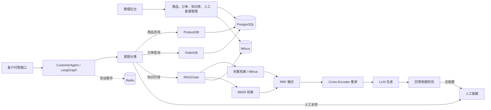

# shopmind-rag

**shopmind-rag** 是一个基于 **PySide6 + LangGraph + Milvus + PostgreSQL** 构建的桌面端智能电商客服系统。项目提供面向消费者的独立问答窗口，以及包含知识库、商品、订单、人工客服、统计和权限管理的后台工作台。

系统将商品咨询、订单查询、知识问答与人工客服转接放入同一条 Agent 工作流中：能够直接处理的请求优先调用业务数据；需要知识依据的问题进入 RAG 检索；资料不足或回答缺乏支撑时转人工处理。

> 本公开版本只保留源码与静态资源。历史会话、账号、日志、商品/订单样例、知识库文档、向量索引和本地配置均已清理。运行时生成的 `data/`、`logs/`、虚拟环境和 IDE 配置不会提交到仓库。

## 项目亮点

- **单 Agent 路由**：使用 LangGraph 将商品、订单、知识库和人工客服路径编排为可追踪的状态图。
- **混合检索**：向量检索与 BM25 关键词检索并行召回，使用 RRF 融合，再以 Cross-Encoder 进行可选重排。
- **回答依据校验**：知识型回答生成后被标记为 `supported`、`partial` 或 `none`；无依据时不直接作答，而是转人工。
- **增量知识入库**：Markdown 文档按标题和句子边界切块，基于文件与 chunk 哈希识别新增、变更和删除内容。
- **多轮上下文**：短对话保留滑动窗口；长对话压缩早期历史并保留最近消息，降低上下文占用。
- **桌面端双入口**：客户问答窗口与后台管理窗口分离，后台按角色显示可访问页面。
- **运行安全**：API Key 支持环境变量覆盖与本地加密存储；订单回复会掩码手机号、姓名和收货地址。

## 架构概览



### Agent 路由流程

```text
resolve → classifier
classifier → product_node / order_node / knowledge_node / human_node
product_node / order_node → generator → END
knowledge_node → generator → answerability → END
knowledge_node（无候选资料）→ human_node → END
answerability（none）→ human_node → END
```

1. `resolve` 结合上下文处理指代问题。
2. `classifier` 先匹配人工、商品和订单关键词；等待手机号时会利用上下文进入订单路径；其他问题进入知识库检索。
3. 商品与订单路径直接查询 PostgreSQL，随后由 LLM 组织回复。
4. 知识路径检索到候选资料后生成回答，并检查回答是否由资料支撑。
5. `supported` 正常返回，`partial` 会追加“仅供参考”提示，`none` 则转人工处理。

## 核心能力

### 1. 商品与订单查询

- 商品数据通过 SQLAlchemy 访问 PostgreSQL，支持名称、分类、关键词和描述的匹配。
- 订单查询支持订单号、快递单号和手机号；未提供手机号时会引导用户补充。
- 面向客户的订单结果会掩码敏感字段：手机号仅展示前 3 位和后 4 位，姓名和地址也会脱敏。

### 2. RAG 检索链

`core/rag/rag_chain.py` 的检索过程如下：

1. 读取 `config/synonyms.json` 扩展同义表达。
2. 调用 Embedding API 生成查询向量，在 Milvus 中召回候选 chunk。
3. 根据 Milvus 中的文档 chunk 构建 BM25 统计量并进行关键词召回。
4. 对两路结果使用 Reciprocal Rank Fusion（`RRF_K = 6`）融合排序。
5. 配置了 Embedding/API Key 时，调用 `BAAI/bge-reranker-v2-m3` 进行 Cross-Encoder 重排；失败时保留 RRF 结果。
6. 仅对重排分数应用相似度阈值；RRF 分数与重排分数量纲不同，不被当作回答可信度。

### 3. 知识库增量更新

后台上传 Markdown 文档时，`DocLoader` 会：

- 计算文件 SHA-256，未变化的文件直接跳过；
- 按 `##` 标题拆分章节，再按句子边界切块；
- 为每个 chunk 生成哈希和稳定 ID；
- 只对新增或变化的 chunk 调用 Embedding；
- 更新 Milvus 中的新增、变化和已删除向量；
- 将本地索引写入 `data/doc_index.json`，以支持下次增量更新。

### 4. 会话、缓存与可观测性

- 会话和消息持久化到 PostgreSQL；Redis 仅作为缓存，失效时自动降级到 PostgreSQL。
- 会话列表、会话元数据、完整会话和 RAG 结果设置了独立 TTL。
- `PerformanceMonitor` 记录调用耗时；日志采用按大小轮转的文件处理器。
- `ContextEngine` 在短对话中保留最近消息，在长对话中摘要早期内容并保留近期原文。

## 功能模块

| 模块 | 说明 |
| --- | --- |
| 客户问答 | 多轮对话、商品咨询、订单查询、知识库问答、人工转接 |
| 工作台 | 后台入口与会话处理工作区 |
| 知识库管理 | Markdown 上传、增量切块、向量化和文档删除 |
| 商品管理 | 商品 CRUD 与库存、规格、关键词维护 |
| 订单管理 | 订单、物流、快递单号和订单追踪查询 |
| 人工客服 | 查看待处理会话并介入回复 |
| 用户与权限 | `admin` 和 `cs` 角色、页面可见性与细粒度权限校验 |
| 统计与性能 | 会话统计、检索/调用性能及运行日志查看 |
| 设置 | LLM 提供商、模型、API 地址、Embedding 与检索参数配置 |

## 技术栈

| 分类 | 技术 |
| --- | --- |
| 语言与桌面端 | Python 3.10+、PySide6、PySide6-Fluent-Widgets |
| Agent 编排 | LangGraph、LangChain |
| LLM 接入 | OpenAI 兼容接口、OpenAI / SiliconFlow / 通义千问 / 智谱 / DeepSeek |
| 检索 | Milvus、Embedding、BM25、RRF、Cross-Encoder Rerank |
| 数据与缓存 | PostgreSQL、SQLAlchemy、Redis、pg8000 |
| 安全 | Fernet、PBKDF2-HMAC-SHA256、Windows DPAPI 备选方案 |

## 快速开始

### 1. 准备环境

```bash
python -m venv .venv

# Windows PowerShell
.venv\Scripts\Activate.ps1

pip install -r requirements.txt
```

项目依赖以下外部服务：

- PostgreSQL：商品、订单、会话和消息主存储；
- Milvus Server：知识库向量存储，默认地址为 `http://localhost:19530`；
- Redis：可选缓存。不可用时，应用会降级为纯 PostgreSQL 会话访问；
- 一个兼容 OpenAI API 的 LLM/Embedding 服务。

本仓库不包含 Docker Compose、数据库导出、知识库文档或 API Key，需要根据本机环境自行准备。

### 2. 配置模型与服务

首次启动会自动创建 `data/settings.json`。也可以在应用的设置页面中填写模型、API 地址和服务配置。

推荐通过环境变量提供密钥，避免将密钥写入配置文件：

```powershell
$env:RAGPROJECT_API_KEY = "<your-llm-api-key>"
$env:EMBEDDING_API_KEY = "<your-embedding-api-key>"
$env:RAGPROJECT_API_BASE_URL = "https://<your-llm-endpoint>/v1"
$env:EMBEDDING_API_BASE_URL = "https://<your-embedding-endpoint>/v1"
```

可用的环境变量包括：

| 用途 | 环境变量 |
| --- | --- |
| LLM Key | `AGNES_API_KEY`、`RAGPROJECT_API_KEY`、`SILICONFLOW_API_KEY`、`OPENAI_API_KEY` |
| LLM Base URL | `RAGPROJECT_API_BASE_URL`、`SILICONFLOW_API_BASE_URL`、`OPENAI_BASE_URL` |
| Embedding Key | `EMBEDDING_API_KEY`、`SILICONFLOW_API_KEY`、`AGNES_API_KEY` |
| Embedding Base URL | `EMBEDDING_API_BASE_URL`、`SILICONFLOW_API_BASE_URL` |

> 不要将包含真实 Key、数据库密码、用户账号或业务数据的 `data/` 目录提交到 Git。

### 3. 启动应用

```bash
# 客户问答窗口
python main.py

# 管理后台
python run_admin.py
```

后台首次运行会创建本地账号数据。默认账号仅用于本地演示，首次登录后应立即修改密码。

## 目录结构

```text
shopmind-rag/
├── config/
│   └── synonyms.json              # 查询改写使用的同义词词典
├── core/
│   ├── agents/                    # LangGraph Agent、上下文、模型路由、会话管理
│   ├── config_utils/              # 配置热更新、权限、校验与 UI 配置
│   ├── data/                      # PostgreSQL、Redis、备份访问层
│   ├── infra/                     # 日志、限流、性能、文件锁、LLM Provider
│   └── rag/                       # 文档切块、Embedding、Milvus、检索与 Prompt
├── resources/                     # 图标与 Qt 样式
├── ui/
│   ├── components/                # 聊天组件
│   ├── dialogs/                   # 登录与设置对话框
│   ├── pages/                     # 工作台、知识库、商品、订单等后台页面
│   └── windows/                   # 客户窗口与后台主窗口
├── main.py                        # 客户问答入口
├── run_admin.py                   # 后台管理入口
└── requirements.txt               # Python 依赖
```

## 权限模型

系统内置两类角色：

| 角色 | 可访问范围 |
| --- | --- |
| `admin` | 工作台、人工客服、知识库、商品、订单、统计、性能、日志、用户管理 |
| `cs` | 人工客服、商品管理、订单管理 |

权限由 `Permission` 枚举和 `require_permission` 装饰器控制；导航菜单根据当前角色动态生成。

## 数据与隐私说明

- 本公开仓库不包含真实客户、商品、订单、会话、知识库或账号数据。
- 本地运行时产生的用户、订单、会话、日志、文档索引、Milvus 数据和配置均位于 `data/`、`logs/` 或外部服务中，应保持在 `.gitignore` 内。
- 如果自行添加演示数据，请使用虚构手机号、订单号、姓名和地址，并在截图中进行脱敏。

## 已知运行前提

- RAG 检索依赖 Milvus 与 Embedding API；未配置时无法得到知识库检索结果。
- 商品、订单和会话功能依赖 PostgreSQL。
- Redis 为可选项，连接失败不会阻止会话主流程。
- 本公开快照未附带 Docker Compose、测试用例和初始业务数据，目的是避免提交运行环境、个人信息和历史数据。

## 许可

本项目用于学习与作品展示。若用于生产环境，请补充部署编排、密钥管理、数据备份、审计、异常恢复和完整测试。
